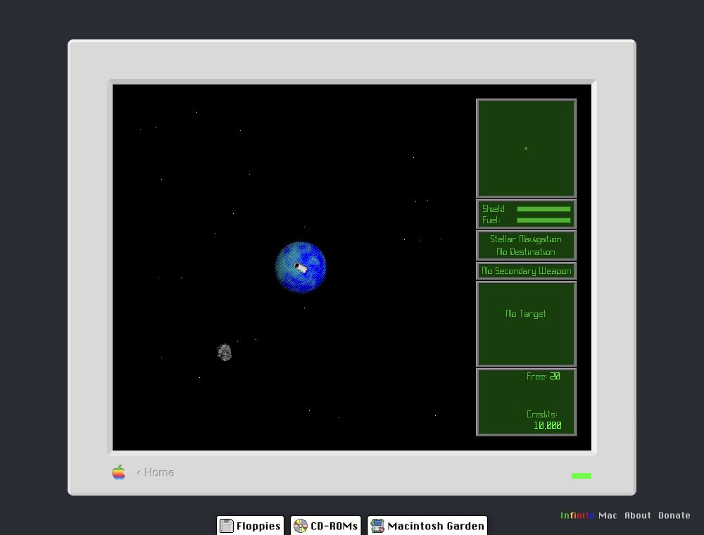
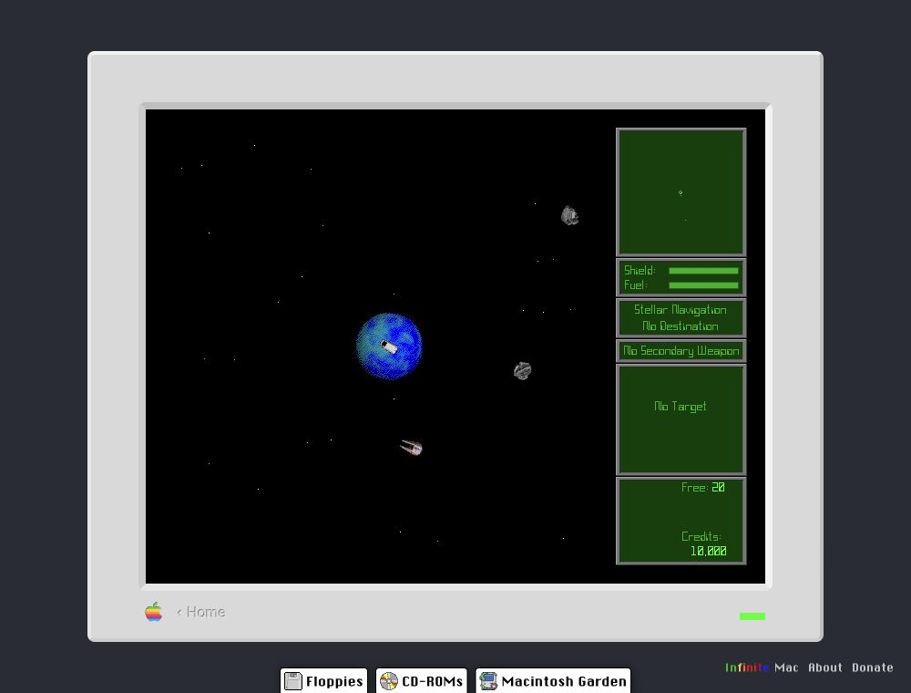

# Asteroid motion and shattered remnants — 0.1.59

## Original reference

On October 20, 2026, the original Escape Velocity 1.0.5 was run in Infinite Mac's Mac OS 7.6 session. After leaving Levo, the player remained stationary over the planet. Asteroids moved independently across the flight area and their visible shapes changed as they tumbled. The original manual also explicitly describes “asteroids drifting across the screen” (decoded manual line 269) and asteroid cover without ship collision damage (line 619).

Captured original flight views:

This is a qualitative visual comparison, not a measurement of the original simulation clock or exact velocities. The remake uses tuned speeds of 12–38 world units per second and main spin rates of 0.25–0.65 radians per second, with smaller rotations on the other axes. Opposite spin directions and independently seeded headings keep the field varied. The existing source system density is unchanged. Positions and rotation are analytic in elapsed simulation time, freeze in menus, and recycle beyond the camera around the pilot. Weapon-cover coordinates update with the visible rocks. No asteroid ship-collision damage was added.

## Remnants

The permanent planetary-remnant spheres are replaced by irregular cratered rock meshes, charred stone and filtered glowing fissures that cool with time. Station debris uses irregular extruded metal plates, exposed hot cut edges and occasional attached spars. Random initial orientation and independent spin make the pieces tumble as they fly outward. The existing bounded count and constant outward velocities remain intact; fragments do not settle into a stationary ring.

Checks cover moving collision coordinates, pause, frame-rate independence, offscreen recycling, ballistic remnant travel, save/reload and system cleanup. Original exact asteroid timing remains unmeasured.
